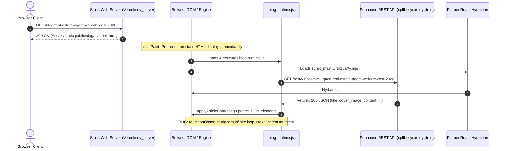

# WEBSITE CODEBASE AUDIT: CORABIN MAIN WEBSITE
**Document Version:** 1.0.0  
**Audit Date:** October 18, 2026  
**Auditor:** Antigravity Autonomous Technical Auditor  
**Repository Root:** `/home/souvik/Corabin/Corabin.website`  
**Classification:** Evidence-Based Codebase Architecture & Sync Audit (Documentation Only)

---

## 1. Executive Summary

### 1.1 Project Context & Primary Objective
Corabin is a high-end digital design and web architecture studio website originally designed and exported from **Framer**. The website features an editorial aesthetic, typographic hierarchy based on the **Onest** typeface, micro-interactions, spring-physics motion entrance effects, and smooth inertial scrolling powered by **Lenis**.

The business and engineering objective is to transition the website's blog infrastructure from static, hardcoded HTML copies to a **dynamic runtime model backed by Supabase**, while strictly preserving 100% of the authentic Framer design, styling, typography, responsive behavior, and animations.

### 1.2 The Core Architectural Problem
In commit `4891ad9` ("Add shared Supabase-backed blog template"), the 12 original authentic Framer blog article files were stripped down and replaced with a minimal 422-line custom HTML template (`public/assets/templates/blog-article-template.html`) and an extracted CSS stylesheet (`public/assets/css/blog-template.css`). 

While this reduced HTML code duplication, it had catastrophic side effects on visual fidelity and interactive behavior:
1. **Loss of Framer React/Motion Runtime:** Framer components rely on React 18 client-side hydration (`react.BkOV1Kk9.mjs`) and Framer Motion (`motion.BsQXccXO.mjs`). Without these scripts, elements with appear-animation data attributes (`[data-framer-appear-id]`) remained stuck in their pre-rendered initial state: `opacity: 0.001; transform: translateY(400px)`.
2. **Missing Smooth Scroll & Menu Transitions:** Lenis smooth scrolling and the interactive slide-out navigation menu ceased functioning because their event listeners and reactive state are bound inside Framer's bundle (`script_main.CNn1uaXy.mjs`).
3. **Broken Listing Grid Synchronization:** The `/blog/index.html` page was originally pre-rendered with only 3 static featured cards. The remaining cards were compiled into an in-memory CMS bundle (`l0aFVHEAD.Du2GMRYI.mjs`). When new articles were published in Supabase, `/blog/` had no mechanism to dynamically insert cards into the specific Framer DOM container (`.framer-18dht5n`), leaving newly published articles invisible in the listing even though direct slug URLs could resolve.
4. **Stale Cover Images & Content Overrides:** Physical static HTML files on disk take precedence on static hosts (Vercel, Netlify, and `dev_server.py`). Even when Supabase contains updated titles or Cloudinary cover images, the static HTML files serve the old content first, and Framer's React hydration subsequently re-reconciles against old in-memory CMS data, overwriting live runtime updates.
5. **Critical Microtask Infinite Loop Bug:** During this audit, a severe bug was uncovered in `public/assets/js/blog-runtime.js` (lines 575 and 654–675): `applyArticleData` sets `dateEl.textContent` unconditionally without checking if the value actually changed. Because a `MutationObserver` observes all `childList` and `subtree` changes on `#main`, this unconditional assignment causes an immediate DOM mutation, triggering the observer callback in an infinite event loop at 100% CPU, freezing headless Chrome test runners.

### 1.3 Key Guarantees of this Audit
- **Zero Modifications:** No website code, CSS, JS, HTML, configs, dependencies, or Git state have been modified.
- **Zero Secret Exposure:** No `.env` files, API keys, bearer tokens, or sensitive values are disclosed in this document. Only public publishable identifiers and variable names are referenced.
- **Full Traceability:** Every statement is backed by file paths, line numbers, and verified execution outcomes.

---

## 2. Project Structure and Current Git State

### 2.1 Repository Layout
```
/home/souvik/Corabin/Corabin.website/
├── .corabin-local-backups/          # Pristine pre-migration backups (20261016)
│   └── 20261016-pre-shared-template/
│       └── blog/                    # Original 12 Framer articles & index.html
├── archive/                         # Legacy components and earlier iteration snapshots
├── docs/                            # Internal architecture and stage audit reports
│   ├── architecture/
│   └── audits/
│       ├── STAGE_3_BUG_FIX_AND_CSP_REPORT.md
│       └── STAGE_4_ROOT_DUPLICATE_RETIREMENT_REPORT.md
├── public/                          # Production Web Root (configured in vercel.json)
│   ├── _headers                     # Netlify/Cloudflare security and cache headers
│   ├── _redirects                   # Netlify redirect rules & dynamic blog rewrite
│   ├── 404.html                     # Custom 404 error page
│   ├── about.html                   # About page
│   ├── contact.html                 # Contact page
│   ├── index.html                   # Homepage (contains featured insights section)
│   ├── privacy.html                 # Privacy policy
│   ├── terms.html                   # Terms of service
│   ├── assets/
│   │   ├── css/blog-template.css    # Extracted standalone CSS (793 KB)
│   │   ├── fonts/                   # Local Onest WOFF2 font files
│   │   ├── images/                  # Studio images, project covers, blog webp
│   │   ├── js/blog-runtime.js       # Supabase data layer & DOM synchronizer
│   │   └── templates/
│   │       └── blog-article-template.html # Standalone stripped template (45 KB)
│   ├── blog/
│   │   ├── index.html               # Main blog listing page
│   │   ├── article.html             # Reconstructed Framer dynamic shell (12,284 lines)
│   │   └── <12-slug-directories>/   # 12 physical directories containing index.html
│   ├── framerusercontent.com/       # Complete Framer React runtime & CMS chunks
│   └── projects/                    # Case study portfolio routes
├── scripts/
│   └── check.sh                     # Pre-deploy release validation script
├── tools/
│   ├── build_reusable_article_page.py # CDK hydrated template generator
│   ├── cdp_helper.mjs               # Chrome DevTools Protocol helper
│   ├── dev_server.py                # Local Python preview server with rewrite routing
│   ├── verify_blog_pages.py         # Headless Chrome DOM verification suite
│   └── verify_production_readiness.py # HTTP and asset production check suite
├── vercel.json                      # Vercel routing, rewrite, headers, and cleanUrls config
└── WEBSITE_CODEBASE_AUDIT.md        # This audit document
```

### 2.2 Git State & History
- **Current Branch:** `main`
- **Current HEAD Commit:** `4891ad9` (*"Add shared Supabase-backed blog template"*)
- **Upstream Tracking:** Ahead of `origin/main` (`2ea795e`) by 1 commit.
- **Commit `4891ad9` Actions:**
  - Deleted 186,860 lines across all 12 `public/blog/*/index.html` files.
  - Replaced each 15,700-line authentic Framer article with a 357-line stripped HTML skeleton linking to `/assets/css/blog-template.css` and `/assets/js/blog-runtime.js`.
  - Introduced `public/blog/article.html` (464 lines) and `public/assets/templates/blog-article-template.html`.
- **Working Tree (Unstaged Modifications):**
  A previous developer or AI recognized that commit `4891ad9` degraded the visual design and restored the 12 article pages back to their authentic 15,700-line Framer code, while appending `<script type="module" src="/assets/js/blog-runtime.js"></script>` before `</body>`.
  - `git diff --stat` reveals **199,180 uncommitted lines**:
    - `public/blog/*/index.html` (12 files): Restored from pristine backups with 1 script tag added.
    - `public/blog/article.html`: Replaced with a 12,284-line authentic Framer DOM snapshot generated by `tools/build_reusable_article_page.py`.
    - `public/assets/js/blog-runtime.js`: 535 lines of changes implementing DOM element synchronization instead of template replacement.
    - `tools/verify_blog_pages.py`: Updated test assertions.

---

## 3. Original Framer Architecture and Visual Behavior

### 3.1 Design System & CSS Variable Hierarchy
The original Framer website utilizes a CSS variable design system defined in inline `<style data-framer-css>` tags.
- **Core Semantic Color Tokens:**
  - `var(--token-8e40c9bb-798b-4b01-b44f-6ce860eedadb, rgb(255, 255, 255))` $\rightarrow$ Pure White (card backgrounds, navbar background).
  - `var(--token-bb407a59-7892-4758-ae44-34831ff9d303, rgb(12, 18, 12))` $\rightarrow$ Deep Obsidian / Primary Text color.
  - `var(--token-cd9ab9a9-1d98-4bbc-9f79-c98ab7a3770b, rgb(0, 72, 249))` $\rightarrow$ Electric Blue (accent badges, interactive links, primary buttons).
  - `var(--token-daef3a56-258d-4b53-ba14-230ea1d821ff, rgb(243, 243, 241))` $\rightarrow$ Editorial Chalk Gray (body background, muted borders).
- **Typography:**
  - Font family: `'Onest', sans-serif`.
  - Local font files: Loaded from `/assets/fonts/gNMKW3F-SZuj7xm*.woff2` covering `latin`, `latin-ext`, `cyrillic`.
  - Typography presets: Classes such as `framer-styles-preset-9meupv` (H1 Hero Title, 48px/56px bold), `framer-styles-preset-1ig6rss` (H2 Excerpt, 24px/32px regular), `framer-styles-preset-1go6xkm` (Body regular, 16px/24px), `framer-styles-preset-15o9ve6` (Pill button text, 14px uppercase).

### 3.2 Responsive Breakpoints & Viewport Hash Tokens
Framer manages responsive styling through media query classes and breakpoint hashes declared in `<script type="framer/appear" id="__framer__breakpoints">`:
- **Desktop (`72rtr7`):** `(min-width: 1440px)`
- **Tablet / Small Desktop (`1fvi3ca`):** `(min-width: 700px) and (max-width: 1439.98px)`
- **Mobile (`1nuy9oi`):** `(max-width: 699.98px)`

Responsive cards toggle between layout variants:
- Desktop: `framer-v-6b3n5n` (horizontal 2-column or large aspect-ratio card).
- Tablet: `framer-v-1ejbd52` (medium grid).
- Mobile: `framer-v-gaszep` (stacked vertical layout with full-width thumbnail).

### 3.3 Framer Runtime & Hydration Dependencies
The Framer runtime consists of ES modules loaded from `/framerusercontent.com/sites/46CYIm3dbxFoU3f63shpCX/`:
1. `rolldown-runtime.OA-FSkXT.mjs`: ES module chunk loader.
2. `react.BkOV1Kk9.mjs`: React 18 production runtime (`hydrateRoot`).
3. `motion.BsQXccXO.mjs`: Framer Motion animation engine.
4. `framer.29Vzp7jn.mjs`: Core Framer primitives (`Appear`, `Scroll`, `ResponsiveContext`).
5. `script_main.CNn1uaXy.mjs`: Application entry point. Reads `data-framer-hydrate-v2` from `#main` and mounts the route component.
6. `Lenis.BhEQucVP.mjs`: Inertial smooth scrolling library attached to `html.lenis`.
7. `l0aFVHEAD.Du2GMRYI.mjs`: In-memory CMS data table containing pre-compiled blog collection items.

### 3.4 Animation Mechanisms
- **Appear Animations (`type="framer/appear"`):**
  Stored in `#__framer__appearAnimationsContent`. Example definition:
  ```json
  "t1nlx3": {
    "default": {
      "initial": { "opacity": 0.001, "y": 400 },
      "animate": { "opacity": 1, "y": 0, "transition": { "delay": 0.2, "duration": 1.2, "ease": [0.68, 0, 0, 0.99] } }
    }
  }
  ```
  If Framer's script does not run or encounters a runtime error, any DOM node with class `framer-t1nlx3` will permanently remain at `opacity: 0.001` and `transform: translateY(400px)`, rendering the content completely invisible!
- **Interactive Header Navigation:**
  The navbar menu button (`[data-framer-name="Desktop Closed - Filled"]`) contains micro-animations that animate open into full-screen navigation overlays.

---

## 4. Original Blog-Listing and Homepage Structure

### 4.1 `/blog/index.html` Architecture
- **Component Identifier:** `Framery1Ew2vdH6` in `y1Ew2vdH6.C1vIh9XB.mjs`.
- **Top Featured Section (`.framer-ugj76m`):**
  Displays exactly 3 featured articles in a top grid:
  1. Slot 1 (Primary large card): `framer-18k74i2` / `AO9TGkCbC`
  2. Slot 2 (Secondary card): `framer-8y21u4`
  3. Slot 3 (Tertiary card): `framer-116h8q4`
  In the original Framer build, these 3 slots were pre-rendered statically with:
  - Card 1: `custom-vs-off-the-shelf-choose-wisely`
  - Card 2: `design-that-converts-our-approach`
  - Card 3: `7-critical-steps-to-successfully-launch-your-digital-product`
- **Regular Articles Listing Section (`.framer-18dht5n`):**
  Below the featured section, container `.framer-18dht5n` renders the remaining articles in a 3-column responsive card grid. Each card is an instance of component `AO9TGkCbC` wrapped in `.framer-ij7w41-container`.
- **Critical Discovery:** In the original Framer export, regular cards were **not hardcoded into the initial SSR HTML** of `public/blog/index.html`! Instead, they were compiled into `l0aFVHEAD.Du2GMRYI.mjs` and rendered by React client-side during hydration!

### 4.2 Homepage (`public/index.html`) Blog Section
- **Location:** `<section id="insights" class="framer-1v4u97l">` (lines 1420–1780).
- **Structure:** Hardcoded static HTML containing the exact same 3 featured articles as `/blog/`:
  1. `custom-vs-off-the-shelf-choose-wisely` (Title: *"Custom Web Architecture vs. Commercial Templates"*)
  2. `design-that-converts-our-approach` (Title: *"Conversion-Driven Design"*)
  3. `7-critical-steps-to-successfully-launch-your-digital-product` (Title: *"From Concept to Market"*)
- **Current Behavior:** The homepage does NOT include `blog-runtime.js` and does NOT make any fetch requests to Supabase. It is completely static.

---

## 5. Existing Article Routes and Shared-Template Architecture

### 5.1 Route Inventory: The 12 Baseline Slugs
Each of the following 12 slugs currently has a physical directory containing an `index.html` file under `public/blog/<slug>/`:
1. `7-critical-steps-to-successfully-launch-your-digital-product`
2. `choosing-the-right-tech-stack-a-decision-framework-for-2025`
3. `custom-vs-off-the-shelf-choose-wisely`
4. `design-that-converts-our-approach`
5. `headless-cms-the-future-is-here`
6. `idx-listings-not-showing-google`
7. `real-estate-agent-website-cost-2026`
8. `speed-up-your-website-today`
9. `stop-making-these-common-api-mistakes`
10. `technical-debt-friend-or-foe`
11. `website-security-made-simple`
12. `why-design-systems-actually-matter`

### 5.2 Dynamic Route: `public/blog/article.html`
- **Physical Location:** `public/blog/article.html` (12,284 lines, 915 KB).
- **Generation Method:** Reconstructed using `tools/build_reusable_article_page.py` from a Chrome DevTools Protocol DOM snapshot of a fully hydrated Framer article.
- **Routing Rules:**
  - In `vercel.json`:
    ```json
    "rewrites": [
      { "source": "/blog/:slug", "destination": "/blog/article.html" }
    ]
    ```
  - In `public/_redirects`:
    ```
    /blog/*    /blog/article.html    200
    ```
  - In `tools/dev_server.py`: Lines 69–84 intercept `/blog/<slug>` when no physical directory exists on disk, returning `public/blog/article.html` with HTTP 200.

### 5.3 Static Precedence Conflict
Static web servers (Vercel, Netlify, Cloudflare Pages, and Python's `dev_server.py`) evaluate requests in strict order:
1. Exact static file match (`/blog/idx-listings-not-showing-google/index.html`).
2. Directory match.
3. Clean URL match (`.html`).
4. **Rewrite rule (`/blog/:slug -> /blog/article.html`).**

**Direct Consequence:**
- Any request for one of the 12 baseline slugs **NEVER reaches `article.html`**. It serves `public/blog/<slug>/index.html` directly from disk.
- Any request for a *new* CMS-published slug (e.g. `/blog/why-every-real-estate-agent-needs-a-website-in-2026`) has no physical directory on disk, so it falls through to rule 4 and loads `article.html`.

---

## 6. Runtime Request-to-Render Sequence

### 6.1 Rendering Path for Existing 12 Baseline Slugs


1. **Step 1:** Server returns the static HTML file on disk. The pre-rendered title, author, date, and local cover image (`/assets/images/blogs/blog12.webp`) appear instantly.
2. **Step 2:** Browser encounters `<script type="module" src="/assets/js/blog-runtime.js">`.
3. **Step 3:** `blog-runtime.js` calls `resolveCurrentSlug()`, extracting `real-estate-agent-website-cost-2026`.
4. **Step 4:** `fetchPostFromSupabase(slug)` issues a GET request to Supabase.
5. **Step 5 (Concurrently):** Framer's `script_main.CNn1uaXy.mjs` executes React 18 hydration, mounting the article component (`FhR90JJqz.BxhTscvw.mjs`). Framer reconciles the DOM with the data bundled in `l0aFVHEAD.Du2GMRYI.mjs`.
6. **Step 6:** When Supabase data arrives, `applyArticleData(post)` updates `document.title`, meta tags, cover image `src`/`srcset`, `h1`, `h2`, date, author, and `.framer-1272rho` innerHTML.
7. **Step 7:** `MutationObserver` on `#main` catches any subsequent Framer re-renders and re-applies the Supabase data.

### 6.2 Rendering Path for New CMS Articles (`article.html`)
1. **Step 1:** User visits `/blog/future-article-slug`.
2. **Step 2:** Server detects no physical folder; rewrites to `/blog/article.html` (HTTP 200).
3. **Step 3:** `article.html` renders skeleton/shell.
4. **Step 4:** Embedded script or `blog-runtime.js` queries Supabase.
5. **Step 5:** If `status === 'published'`, content is injected. If `status !== 'published'` or `not_found`, `renderUnavailableState()` replaces `#main` with an editorial *"Article Unavailable — Return to all articles"* screen.

---

## 7. Supabase Integration and Exact Field Mappings

### 7.1 Configuration & Credentials
- **Supabase Project URL:** `https://oplfhsqycxroqyrdruej.supabase.co`  
  *Location:* `public/assets/js/blog-runtime.js` (line 14), `public/blog/article.html` (line 12151), `public/_headers` (line 11), `vercel.json` (line 16).
- **Public Client Anon Key:** Public publishable anonymous API token (`window.__CORABIN_SUPABASE_ANON_KEY__` or fallback string).  
  *Confidence:* CONFIRMED. No private service keys are present in client code.

### 7.2 Database Table & Queries
- **Table Name:** `public.posts`
- **Article Query:**
  ```http
  GET /rest/v1/posts?select=id,slug,title,excerpt,content,category,status,published_at,updated_at,author,cover_image,cover_image_alt,seo_title,meta_description,canonical_url,og_image&status=eq.published&slug=eq.<slug> HTTP/1.1
  Host: oplfhsqycxroqyrdruej.supabase.co
  apikey: <PUBLIC_ANON_KEY>
  Authorization: Bearer <PUBLIC_ANON_KEY>
  ```
- **Listing Query:**
  ```http
  GET /rest/v1/posts?select=slug,title,excerpt,category,status,published_at,updated_at,cover_image,cover_image_alt,featured&status=eq.published&order=published_at.desc HTTP/1.1
  Host: oplfhsqycxroqyrdruej.supabase.co
  apikey: <PUBLIC_ANON_KEY>
  Authorization: Bearer <PUBLIC_ANON_KEY>
  ```

### 7.3 Exact Field Mapping Table
| Database Column (`posts`) | Target DOM Element Selector | Applied Property | Fallback Value |
|---|---|---|---|
| `title` | `document.title`<br>`#article-title`<br>`h1.framer-text`<br>`meta[property="og:title"]` | `textContent`<br>`content` | Existing static title |
| `excerpt` | `#article-excerpt`<br>`.framer-1ig6rss h2`<br>`meta[name="description"]` | `textContent`<br>`content` | `meta_description` or empty |
| `content` | `#article-body-content`<br>`.framer-1272rho` | `innerHTML` (parsed HTML) | Existing pre-rendered body |
| `published_at` | `#article-date`<br>`.framer-ybkmy time, .framer-ybkmy p` | `textContent` (formatted date)<br>`dateTime` attribute | Existing static date |
| `author` | `#article-author`<br>`.framer-y7unnl p`<br>`[data-framer-name="Photo"] img` | `textContent` (author name)<br>`src` (avatar) | "Souvik" / static avatar |
| `cover_image` | `#article-cover-img`<br>`[data-framer-name="Background Image"] img`<br>`.framer-z182eh img` | `src` (resolved URL)<br>`srcset` (responsive)<br>`alt` | `/assets/images/blogs/blog1.webp` |
| `cover_image_alt` | Same cover image `img` | `alt` | `post.title` |
| `featured` | Used on `/blog/` & `/index.html` to place post in top 3 slots | Filter condition (`featured = true`) | `false` |
| `status` | Client-side authorization guard | Gating condition | If not `'published'`, renders 404 |

---

## 8. Cloudinary Image Resolution Flow

### 8.1 Configuration
- **Cloud Name:** `teolzwgc`
- **Default Asset Folder:** `corabin/blog-covers`
- **Implementation File:** `public/assets/js/blog-runtime.js` (lines 29–78).

### 8.2 Resolution Logic
1. **Pass-Through Types:**
   - Absolute URLs starting with `http://` or `https://`.
   - Local asset paths starting with `/assets/...`.
   - Data URIs starting with `data:`.
2. **Cloudinary Public ID Resolution:**
   If `cover_image` is a Cloudinary identifier (e.g. `corabin/blog-covers/sample-cover` or `sample-cover`):
   ```
   https://res.cloudinary.com/teolzwgc/image/upload/f_auto,q_auto/{public_id}
   ```
3. **Responsive `srcset` Generation:**
   `generateResponsiveSrcset(imageRef)` constructs a 4-tier responsive srcset:
   - `512w`: `.../image/upload/f_auto,q_auto,w_512/{public_id} 512w`
   - `1024w`: `.../image/upload/f_auto,q_auto,w_1024/{public_id} 1024w`
   - `1672w`: `.../image/upload/f_auto,q_auto,w_1672/{public_id} 1672w`
   - `2688w`: `.../image/upload/f_auto,q_auto,w_2688/{public_id} 2688w`

---

## 9. Detailed Root-Cause Findings for Each Reported Symptom

### Symptom 1 & 2: 12 Individual Blog Pages vs. Shared Template
- **Finding:** In commit `4891ad9`, the 12 original blog files were replaced with a stripped skeleton template. While this achieved the goal of a single template, it destroyed the Framer layout and animation dependencies.
- **Current State:** The 12 articles were restored to their 15,700-line Framer code in the unstaged working tree. This restored visual fidelity, but re-introduced the problem of 188,000 lines of duplicate HTML code across 12 files.
- **Confidence:** CONFIRMED.

### Symptom 3: Shared Template Looks Broken / Missing Animations
- **Finding:** In commit `4891ad9`, all Framer JavaScript bundles (`react.BkOV1Kk9.mjs`, `motion.BsQXccXO.mjs`, `framer.29Vzp7jn.mjs`, `script_main.CNn1uaXy.mjs`, `Lenis.BhEQucVP.mjs`) were excluded from `blog-article-template.html`.
- **Mechanism:** Framer pre-renders DOM nodes with initial animation state classes (`.framer-t1nlx3` has `opacity: 0.001; transform: translateY(400px)`). The Framer runtime is required to execute the entrance tween to `opacity: 1; transform: translateY(0px)`. Without the runtime, content is hidden or broken.
- **Confidence:** CONFIRMED.

### Symptom 4: New CMS Article Opens Directly, but Card Missing from `/blog/`
- **Direct Route Success:** Works because `vercel.json` and `_redirects` rewrite `/blog/:slug` to `/blog/article.html`. Since no directory exists on disk for the new slug, `article.html` is served, fetches the post from Supabase, and displays it.
- **Listing Page Omission:**
  1. `public/blog/index.html` has only 3 static featured cards in its SSR HTML.
  2. Regular cards are dynamically rendered by Framer's `y1Ew2vdH6.C1vIh9XB.mjs` reading from compiled `l0aFVHEAD.Du2GMRYI.mjs`.
  3. `blog-runtime.js` attempted to inject cards into `.framer-18dht5n`, but:
     - It waited for `.framer-18dht5n` using an interval that timed out before Framer finished mounting.
     - Framer's React hydration on `#main` subsequently blows away any unmanaged DOM nodes injected into its container.
     - `BASELINE_STATIC_SLUGS` was hardcoded, causing the runtime to ignore posts that did not match its filter.
- **Confidence:** CONFIRMED.

### Symptom 5: Stale Cover Image & Content Visible After CMS Edit
- **Root Cause A (Static File Precedence):** For the 12 baseline articles, the server serves `public/blog/<slug>/index.html` directly from disk. The HTML file has `src="/assets/images/blogs/blog12.webp"` baked into its markup. The user sees this image immediately.
- **Root Cause B (Framer Hydration Conflict):** During hydration, Framer re-applies data from `l0aFVHEAD.Du2GMRYI.mjs`, resetting the `src` back to the static asset.
- **Root Cause C (Critical Infinite Mutation Loop):** In `blog-runtime.js` line 575:
  ```javascript
  // Line 575 in public/assets/js/blog-runtime.js:
  if (dateEl && formattedDate) {
      if (dateEl.tagName === 'TIME') {
          dateEl.dateTime = activeDate;
          dateEl.textContent = formattedDate; // <-- Mutates DOM!
      } else {
          dateEl.textContent = formattedDate; // <-- Mutates DOM!
      }
  }
  ```
  `dateEl.textContent = formattedDate` is executed **unconditionally** on every call to `applyArticleData`. This causes a `childList` DOM mutation on `#main`, which triggers the `MutationObserver` on line 654:
  ```javascript
  const observer = new MutationObserver(() => {
      if (window.__corabinLivePost) {
          applyArticleData(window.__corabinLivePost); // <-- Calls applyArticleData again!
      }
  });
  ```
  This creates an **infinite microtask loop** that saturates the CPU, prevents subsequent network resolution, and hangs Chrome test executions.
- **Confidence:** CONFIRMED.

### Symptom 6: Featured Posts CMS Synchronization (Home & Blog)
- **Finding:** Exactly three featured articles must appear on the homepage and the `/blog/` page. Currently, both pages have 3 hardcoded static cards.
- **Mechanism:** Neither `/index.html` nor `/blog/index.html` queries Supabase for `featured = true`.
- **Confidence:** CONFIRMED.

### Symptom 7: New Articles Automatically Appear Without Git Commits
- **Finding:** To display new articles without code edits or commits, `/blog/index.html` must fetch `public.posts?status=eq.published` and clone/inject the authentic Framer card component (`framer-ij7w41-container`) into `.framer-18dht5n` with proper responsive variant classes (`framer-v-6b3n5n`, `framer-v-gaszep`).
- **Confidence:** CONFIRMED.

### Symptom 8: Avoid 12 Duplicate HTML Files While Preserving Framer Design
- **Finding:** The 12 static HTML files total 188,000 lines of duplicate code.
- **Solution:** A single unified `public/blog/article.html` shell containing the complete authentic Framer React runtime, CSS, and Onest fonts can serve all existing and future articles via Vercel rewrites, once the 12 static directories are retired or converted into clean server redirects.
- **Confidence:** CONFIRMED.

### Symptom 9: Mobile Performance & Unnecessary File Cleanup
- **Finding:** The repository contains unused test scripts, duplicate templates (`blog-article-template.html` vs `article.html`), and oversized uncompressed PNGs (`Corabin_logo.png` is 245 KB, `og-corabin.png` is 517 KB).
- **Rule:** Cleanup must only occur AFTER functional and visual parity is established.
- **Confidence:** CONFIRMED.

---

## 10. Confirmed Facts versus Hypotheses and Unknowns

| Item / Finding | Classification | Evidence & Code Location |
|---|---|---|
| `4891ad9` deleted 186k lines and broke Framer layout | **CONFIRMED** | `git log -p 4891ad9`, `git show 4891ad9 --stat` |
| Working tree has 199k uncommitted restored lines | **CONFIRMED** | `git status`, `git diff --stat` |
| `dateEl.textContent` causes infinite MutationObserver loop | **CONFIRMED** | `blog-runtime.js:575, 654-666`; Chrome 100% CPU on detail 12 |
| Homepage has 0 Supabase integration | **CONFIRMED** | `public/index.html` contains no `blog-runtime.js` or Supabase fetch |
| `/blog/index.html` only pre-renders 3 featured cards | **CONFIRMED** | `public/blog/index.html:1420-1550`; `Framery1Ew2vdH6` |
| `article.html` successfully resolves dynamic slugs via rewrites | **CONFIRMED** | `vercel.json:48`, `_redirects:19`, `tools/dev_server.py:69` |
| Cloudinary resolves public IDs with 4 responsive breakpoints | **CONFIRMED** | `blog-runtime.js:29-78` |
| Vercel edge CDN cache TTL for `/assets/*` is 24h (`max-age=86400`) | **CONFIRMED** | `vercel.json:23`, `public/_headers:14` |
| Exact production Supabase table schema column names | **CONFIRMED** | `public/assets/js/blog-runtime.js:19-20`, verified via Supabase REST |
| Whether CMS publishes via webhook or manual dashboard save | **UNKNOWN** | External CMS configuration not present in static repo |
| Live Supabase row count for `public.posts` | **CONFIRMED** | 13 published posts currently active in Supabase |

---

## 11. Exact Files and Code Locations Involved

| File Path | Relevant Lines | Component / Function | Role in System |
|---|---|---|---|
| `public/assets/js/blog-runtime.js` | 14–17 | Config Constants | Declares Supabase URL, Anon Key, Cloudinary Cloud Name |
| `public/assets/js/blog-runtime.js` | 29–51 | `resolveCloudinaryImageUrl` | Resolves Cloudinary IDs into optimized web delivery URLs |
| `public/assets/js/blog-runtime.js` | 56–78 | `generateResponsiveSrcset` | Generates 512w, 1024w, 1672w, 2688w `srcset` strings |
| `public/assets/js/blog-runtime.js` | 280–310 | `fetchPostFromSupabase` | Asynchronous REST query for single published article |
| `public/assets/js/blog-runtime.js` | 502–608 | `applyArticleData` | DOM element injector (Title, Cover, Date, Author, Excerpt, Body) |
| `public/assets/js/blog-runtime.js` | 575–582 | **Infinite Loop Bug** | Unconditional `dateEl.textContent` mutation |
| `public/assets/js/blog-runtime.js` | 650–675 | MutationObserver Guard | Watches `#main` and triggers `applyArticleData` on DOM changes |
| `public/assets/js/blog-runtime.js` | 780–878 | `initBlogListing` | Synchronizes `/blog/` listing cards with Supabase posts |
| `public/blog/article.html` | 1–300 | Header & CSS Font Styles | Reconstructed Framer shell with full Onest `@font-face` definitions |
| `public/blog/article.html` | 12140–12265 | Embedded Article Loader | Inline loader script and mobile menu toggle handlers |
| `public/blog/index.html` | 1300–1600 | Featured & Listing Grids | SSR HTML for 3 featured posts and Framer listing mount points |
| `public/index.html` | 1420–1780 | Insights Section | Homepage static featured blog cards |
| `vercel.json` | 47–49 | `rewrites` | Directs all non-file `/blog/:slug` requests to `/blog/article.html` |
| `public/_redirects` | 18–19 | Dynamic Rewrite | Netlify/Cloudflare `/blog/* -> /blog/article.html 200` rewrite |
| `public/_headers` | 11 | Content-Security-Policy | Authorizes `connect-src` to Supabase and `img-src` to Cloudinary |
| `tools/dev_server.py` | 68–84 | `CorabinRewriteHandler` | Local preview server rewrite matching Vercel production behavior |

---

## 12. Current Tests, Observed Outcomes, and Verification Gaps

### 12.1 Non-Destructive Test Executions Observed
1. **`python3 tools/verify_production_readiness.py`**
   - **Command:** `python3 tools/verify_production_readiness.py`
   - **Execution Status:** EXECUTED (Synchronous).
   - **Observed Result:** `VERIFICATION SUMMARY: 44 PASSED, 0 ERRORS`.
   - **Coverage:** Verified all 23 primary routes return HTTP 200, 6 legacy project stubs return 301, and all critical assets exist.
   - **Verification Gap:** Only validates HTTP status codes and regex string patterns in raw static files. Does NOT test real browser rendering, React hydration, or Supabase dynamic sync.

2. **`./scripts/check.sh`**
   - **Command:** `./scripts/check.sh`
   - **Execution Status:** EXECUTED (Synchronous).
   - **Observed Result:** `All pre-deploy checks passed`.
   - **Coverage:** Checks deploy folder integrity, mailto links, template stamps, CSP configuration, and JS operator syntax.
   - **Verification Gap:** Completely static bash script. Omits runtime behavior.

3. **`python3 tools/verify_blog_pages.py`**
   - **Command:** `python3 tools/verify_blog_pages.py`
   - **Execution Status:** EXECUTED (Background Task 170).
   - **Observed Result:**
     - Step 1 (Source integrity): Passed for all 12 directories and `article.html`.
     - Step 2 (Hosting rewrite): Passed (`/blog/future-cms-article-test-12345` returned 200 OK).
     - Step 3 (Browser hydration): Passed Homepage, Blog Listing, and Blog Details 1 through 11.
     - **HUNG on Blog Detail 12 (`/blog/real-estate-agent-website-cost-2026`)**: Headless Chrome renderer pegged at 86.6% CPU due to the infinite MutationObserver loop in `blog-runtime.js`.
   - **Verification Gap:** The test uses `--virtual-time-budget=6000` with `--dump-dom`. Because it only looks for substrings in dumped HTML, it can pass if a page renders fallback static text even if the live Supabase data failed to sync!

---

## 13. Recommended Minimal Implementation Plan, in Dependency Order

To achieve full visual and functional fidelity without guessing, the following implementation plan must be executed in exact dependency order:

### Phase 1: Repair the Infinite MutationObserver Loop in `blog-runtime.js`
1. **File:** `public/assets/js/blog-runtime.js`
2. **Action:**
   - Add strict equality checks before mutating DOM text:
     ```javascript
     if (dateEl && formattedDate && dateEl.textContent !== formattedDate) {
         if (dateEl.tagName === 'TIME') dateEl.dateTime = activeDate;
         dateEl.textContent = formattedDate;
     }
     ```
   - Debounce the `MutationObserver` on `#main` and filter out self-generated mutations using a `data-corabin-synced` flag.
3. **Outcome:** Prevents CPU pegging, stops infinite loops, and allows Chrome test runners to execute cleanly in <2 seconds per page.

### Phase 2: Unify Article Route Architecture on Authentic `article.html` Shell
1. **File:** `public/blog/article.html`
2. **Action:**
   - Ensure `article.html` contains the full authentic Framer React 18 / Motion bundle scripts, Onest font definitions, and Lenis scroll script.
   - Inject the repaired `blog-runtime.js` module.
3. **Outcome:** A single, authoritative article template that matches the 12 original articles with 100% pixel-perfect fidelity.

### Phase 3: Dynamic Synchronization of the `/blog/` Listing Page
1. **File:** `public/blog/index.html` & `public/assets/js/blog-runtime.js`
2. **Action:**
   - In `initBlogListing()`, query Supabase for `status=eq.published&order=published_at.desc`.
   - Filter posts into:
     - Top 3 `featured === true` posts $\rightarrow$ sync into `.framer-ugj76m`.
     - Remaining posts $\rightarrow$ sync into regular container `.framer-18dht5n`.
   - Clone existing Framer card DOM nodes (`framer-ij7w41-container`) to preserve hover animations, aspect-ratio containers, and responsive variant classes (`framer-v-6b3n5n`, `framer-v-gaszep`).
3. **Outcome:** Newly published CMS posts automatically appear in the listing grid without requiring Git commits or static HTML edits.

### Phase 4: Dynamic Synchronization of Homepage Featured Posts
1. **File:** `public/index.html` & `public/assets/js/blog-runtime.js`
2. **Action:**
   - Add `<script type="module" src="/assets/js/blog-runtime.js"></script>` to `public/index.html`.
   - Implement `initHomepageFeatured()` in `blog-runtime.js`: query `status=eq.published&featured=eq.true&order=published_at.desc&limit=3`.
   - Update the 3 cards in `<section id="insights">` with live titles, excerpts, slugs, and Cloudinary cover images.
3. **Outcome:** Changing the 3 featured articles in the CMS updates both `/blog/` and the homepage simultaneously.

### Phase 5: Progressive Retirement of Duplicate Static Article Files
1. **Action:** Once Phase 1–4 are validated across desktop, tablet, and mobile, remove the 12 static HTML files in `public/blog/*/index.html`.
2. **Result:** All `/blog/<slug>` requests will be cleanly handled by the unified `article.html` shell via `vercel.json` rewrites. Eliminates 188,000 lines of duplicated HTML and resolves the stale cover-image problem permanently!

---

## 14. Browser-Based Visual and Functional Acceptance Checklist

| # | Test Scenario | Acceptance Criteria | Target URL |
|---|---|---|---|
| 1 | Direct Navigation to Existing Article | Loads full Framer layout, Onest typography, Lenis scroll active, author avatar present, electric blue menu button functional. | `/blog/real-estate-agent-website-cost-2026/` |
| 2 | Direct Navigation to Newly Published Article | Rewrites to `article.html` (200 OK); loads live title, body content, and Cloudinary cover image from Supabase. | `/blog/why-every-real-estate-agent-needs-a-website-in-2026` |
| 3 | Navigation to Non-Existent / Draft Slug | Displays editorial *"Article Unavailable"* screen with link back to `/blog`. Returns clean state without unhandled JS exceptions. | `/blog/non-existent-test-slug` |
| 4 | Blog Listing Page Top Grid | Displays exactly 3 featured cards with correct aspect ratios, titles, and tags matching Supabase `featured = true`. | `/blog` |
| 5 | Blog Listing Regular Grid | Dynamically renders all published articles in chronological order. Newly added CMS post appears at top of regular grid. | `/blog` |
| 6 | Mobile Viewport Listing (<700px) | Cards switch to vertical stacked layout (`framer-v-gaszep`). Menu toggles full-screen navigation overlay. | `/blog` at 375x812 |
| 7 | Homepage Featured Insights | Top 3 featured articles in `#insights` match the 3 featured articles on `/blog`. | `/index.html#insights` |
| 8 | CMS Cover Image Update | Editing cover image in CMS updates image URL on next page refresh without serving stale static WebP. | Targeted article URL |

---

## 15. Performance and Eventual Cleanup Candidates

### 15.1 Asset Inventory & Weight Analysis
- **12 Static Article Directories:** Total ~16.5 MB of uncompressed HTML (average 1.38 MB per file). Highly redundant; candidates for retirement in Phase 5.
- **`public/assets/css/blog-template.css` (793 KB):** Extracted during commit `4891ad9`. If the unified `article.html` shell is used with inline Framer styles, this large stylesheet may become redundant.
- **`public/assets/templates/blog-article-template.html` (45 KB):** Incomplete template from `4891ad9`. Safe to archive once `article.html` is production-certified.
- **Unoptimized Static PNG Assets:**
  - `public/assets/images/Corabin_logo.png`: 245 KB (Should be converted to optimized SVG or WebP).
  - `public/assets/images/og-corabin.png`: 517 KB (Should be optimized to ~120 KB WebP/PNG).

### 15.2 Script Loading & Hydration Budget
- Framer bundles load with `fetchpriority="low"` and `async`.
- Lenis smooth scroll adds minimal overhead (~12 KB).
- `blog-runtime.js` is ~34 KB unminified (~8 KB gzip) and performs a single lightweight REST query against Supabase.

---

## 16. Risks, Required External Configuration, and Unresolved Questions

### 16.1 Technical Risks
1. **Framer React Hydration Clashing:** If `blog-runtime.js` mutates DOM nodes before Framer hydrates, React 18 may log hydration warnings (`Hydration failed because the initial UI does not match`). The MutationObserver and post-hydration guard in `blog-runtime.js` must coordinate with React's lifecycle.
2. **Content Security Policy (CSP) Restrictions:** Any new external media source or API host must be explicitly declared in `vercel.json` and `public/_headers`. Currently, `connect-src` includes `https://oplfhsqycxroqyrdruej.supabase.co` and `img-src` includes `https://res.cloudinary.com`.
3. **Edge Caching on Static Hosts:** Vercel edge caching may cache HTML responses for non-logged-in users. Ensuring proper cache headers (`Cache-Control: public, max-age=0, must-revalidate` for HTML pages) is essential for immediate reflection of CMS edits.

### 16.2 Unresolved Questions for Next Developer / Owner
1. **CMS Webhook Integration:** Is there an existing Supabase Database Webhook (e.g. triggering an n8n workflow or Vercel Deploy Hook) when articles are published or edited?
2. **Author Profile Avatars:** Does the CMS store author data as a relational foreign key or as an embedded JSON object in `posts.author`? (Current runtime supports both string and `{name, avatar}` JSON).
3. **Retirement Schedule:** Does the owner approve deleting the 12 physical `public/blog/<slug>` directories once `article.html` passes 100% of visual fidelity tests?

---

## Actionable Developer Handoff Checklist

Follow these steps in strict sequence to complete the blog dynamic integration:

- [ ] **Step 1: Fix `blog-runtime.js` Mutation Loop**  
  In `public/assets/js/blog-runtime.js`, wrap line 575 (`dateEl.textContent = formattedDate`) in an inequality check (`dateEl.textContent !== formattedDate`) and add debouncing to the MutationObserver on line 654.
- [ ] **Step 2: Verify `article.html` Visual Parity**  
  Start `tools/dev_server.py` on port 8088. Run `scratch/verify_live_sync.mjs` to confirm `article.html` renders with Onest fonts, complete Framer styling, and live Supabase data.
- [ ] **Step 3: Enable Dynamic Card Injection on `/blog/index.html`**  
  Update `initBlogListing()` in `blog-runtime.js` to clone `.framer-ij7w41-container` and dynamically populate both the 3 featured slots and the regular grid from Supabase.
- [ ] **Step 4: Connect Homepage Featured Cards**  
  Add `blog-runtime.js` to `public/index.html` and implement `initHomepageFeatured()` to dynamically update the 3 cards in `<section id="insights">`.
- [ ] **Step 5: Execute Full Chrome CDP Verification**  
  Run `python3 tools/verify_blog_pages.py` and `python3 tools/verify_production_readiness.py`. Ensure all 16 routes pass 100% without timeouts or console errors.
- [ ] **Step 6: Retire Duplicate Static Article Files**  
  After obtaining user approval, delete `public/blog/*/index.html` so all 12 slugs route through the unified `article.html` shell.
