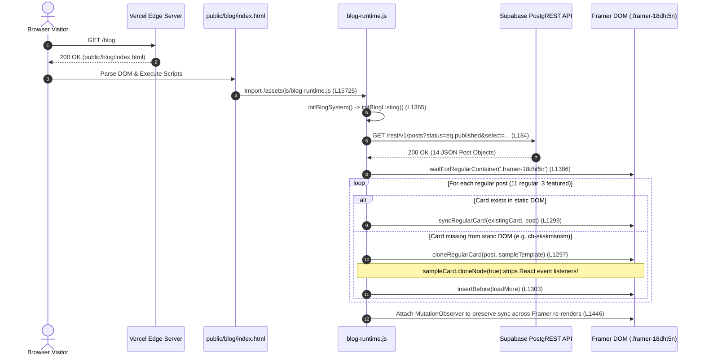
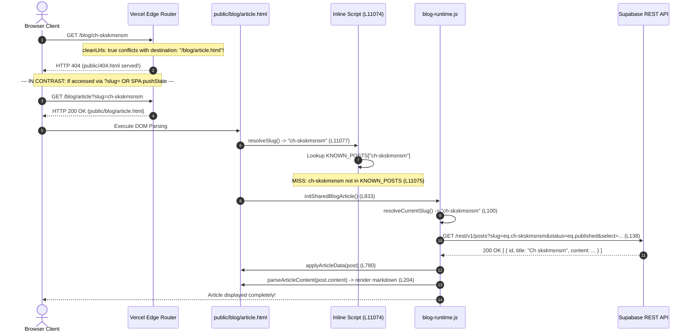

# Technical Audit Report: Corabin Production Blog Runtime & Routing System

**Audit Reference:** `CORABIN-AUDIT-2026-002`  
**Date of Audit:** October 21, 2026  
**Auditor:** Senior Full-Stack Systems & Architecture Engineer  
**Workspace:** `/home/souvik/Corabin/Corabin.website`  
**Production Domain:** `https://www.corabin.com`  
**Investigation Mode:** Read-Only Technical Audit & Empirical Telemetry Analysis  

---

## 1. Executive Summary of the Symptoms

The owner of Corabin reported a set of perplexing data-consistency and routing discrepancies between the custom blog CMS dashboard and the live production website:

1. **Total Article Count in Database:** The CMS dashboard displays **14 total articles** in the database.
2. **Reported Live Count:** The CMS dashboard reports **12 live articles** on the production website.
3. **Status Discrepancy:** The CMS flags two specific articles as `Not in Production`:
   - `Why Every Real Estate Agent Needs a Website in 2026`
   - `Ch skskmsnsm`
4. **Website Listing Discrepancy:** Contrary to the CMS's reported count of 12 live articles, the public website's blog listing (`https://www.corabin.com/blog`) displays **all 14 articles**.
5. **Example Article A Anomaly:** The article titled `Why Every Real Estate Agent Needs a Website in 2026` (slug: `why-every-real-estate-agent-needs-a-website-in-2026`) appears in the public listing, can be clicked, and opens successfully with its complete cover image, metadata, and article body rendered—even though the CMS labels it `Not in Production`.
6. **Example Article B Anomaly:** The article titled `Ch skskmsnsm` (slug: `ch-skskmsnsm`) is also visible in the public blog listing. Its link points to:
   `https://www.corabin.com/blog/ch-skskmsnsm/`
   However, clicking this card immediately navigates to a **404 Page Not Found**.

### Audit Verdict Summary
Our read-only code trace and empirical production telemetry confirm that the reported symptoms are caused by a **three-way architectural divergence**:

1. **Schema & Filter Desynchronization:** In the Supabase `public.posts` table, there are two distinct status fields: `status` (which controls publication state) and `production_status` (an auxiliary editorial field). All 14 articles in Supabase currently have `status = 'published'`. However, only 12 have `production_status = 'live_on_site'`; the two newer articles (`why-every-real-estate...` and `ch-skskmsnsm`) have `production_status = 'not_in_production'`. The CMS dashboard reads `production_status`, thereby reporting 12 live and 2 not in production. In contrast, the website runtime (`public/assets/js/blog-runtime.js:184`) queries strictly on `status=eq.published` and does not check `production_status`. Consequently, all 14 articles are returned and rendered in the public listing.
2. **The Vercel Edge Clean-URL Rewrite Bug (Root Cause of Direct 404s):** In `vercel.json`, `cleanUrls: true` is combined with a rewrite destination specifying a `.html` extension:
   ```json
   { "source": "/blog/:slug", "destination": "/blog/article.html" }
   ```
   When Vercel processes clean URLs, requests targeting or rewritten to `.html` files trigger internal redirects or fail to match the clean URL routing pipeline. As a result, **every single direct HTTP GET request to ANY blog article slug** on Vercel returns an HTTP 404 from Vercel's edge cache (confirmed via curl on `https://www.corabin.com/blog/why-every-real-estate-agent-needs-a-website-in-2026` and `https://www.corabin.com/blog/idx-listings-not-showing-google`).
3. **DOM Cloning Event Stripping vs. Framer SPA Routing (The Click Behavior Split):**
   - Article A (`why-every-real-estate...`) was manually added to Framer's baseline static sets (`BASELINE_STATIC_SLUGS` in `blog-runtime.js:889` and `KNOWN_POSTS` in `article.html:11075`). Its card is hydrated with Framer's React synthetic click handlers. Clicking it executes client-side SPA navigation (`history.pushState`), changing the browser URL without making an HTTP request to Vercel's edge. The client runtime then queries Supabase from the browser and successfully hydrates the page.
   - Article B (`ch-skskmsnsm`) was created purely at runtime by cloning a sample card (`sampleCard.cloneNode(true)` in `blog-runtime.js:1253`). Native `cloneNode(true)` copies DOM elements and attributes but **does not copy JavaScript/React event listeners**. Clicking this card triggers an unintercepted native browser navigation to `https://www.corabin.com/blog/ch-skskmsnsm/`. The browser sends an HTTP request to Vercel, Vercel strips the trailing slash (308 to `/blog/ch-skskmsnsm`), hits the broken rewrite rule, fails to find a static file, and serves `public/404.html` with an HTTP 404 status.

---

## 2. Verified Project Stack and Routing Architecture

### Technical Stack Identification
Inspection of `/home/souvik/Corabin/Corabin.website` confirms the following architecture:
- **Build Origin:** Framer web export (React 18 + Framer Motion runtime compiled into ES modules under `public/framerusercontent.com/`).
- **Static Hosting Directory:** `public/` (defined in `vercel.json:2`).
- **Deployment Platform:** Vercel Static Hosting.
- **Data Layer:** Supabase PostgREST API (`public.posts` table) queried over HTTPS using vanilla browser `fetch()`.
- **Media Asset Pipeline:** Cloudinary (`res.cloudinary.com/teolzwgc/`), delivering responsive multi-resolution WebP/AVIF/JXL formats via `generateResponsiveSrcset()`.
- **Client Runtime Orchestrator:** `public/assets/js/blog-runtime.js` (a custom 1,641-line ES module).

### Routing Configuration Inspection
The primary routing rules are defined in [vercel.json](file:///home/souvik/Corabin/Corabin.website/vercel.json):
```json
1: {
2:   "outputDirectory": "public",
3:   "cleanUrls": true,
4:   "trailingSlash": false,
...
47:   "rewrites": [
48:     { "source": "/blog/:slug", "destination": "/blog/article.html" }
49:   ]
50: }
```
An auxiliary fallback exists in [public/_redirects](file:///home/souvik/Corabin/Corabin.website/public/_redirects):
```text
19: /blog/*                   /blog/article.html  200
```

### Static Asset Layout
- Listing Shell: `public/blog/index.html` (15,728 lines, 1.38 MB).
- Shared Article Template Shell: `public/blog/article.html` (12,171 lines, 920 KB).
- 404 Error Page: `public/404.html` (10,950 lines, 817 KB).
- Client Runtime: `public/assets/js/blog-runtime.js` (1,641 lines, 64 KB).

There are **no physical static subdirectories** for individual article slugs under `public/blog/` (e.g., there is no `public/blog/ch-skskmsnsm/index.html` or `public/blog/ch-skskmsnsm.html`). Every individual article page relies completely on dynamic edge rewriting to `public/blog/article.html`, where client-side JavaScript reads the requested slug from `window.location.pathname` and fetches the post from Supabase.

---

## 3. Blog-Listing Data Flow

### Sequence of Execution


### Detailed Code References

1. **Initialization:**
   At [public/blog/index.html:15725](file:///home/souvik/Corabin/Corabin.website/public/blog/index.html#L15725):
   ```html
   <script type="module" src="/assets/js/blog-runtime.js"></script>
   ```
   On `DOMContentLoaded` or immediate ready state, `initBlogSystem()` executes ([blog-runtime.js:1471-1509](file:///home/souvik/Corabin/Corabin.website/public/assets/js/blog-runtime.js#L1471-L1509)). It inspects `window.location.pathname` and confirms the route is `/blog`, invoking `initBlogListing()` ([blog-runtime.js:1365](file:///home/souvik/Corabin/Corabin.website/public/assets/js/blog-runtime.js#L1365)).

2. **Supabase Listing Query:**
   In [public/assets/js/blog-runtime.js:180-199](file:///home/souvik/Corabin/Corabin.website/public/assets/js/blog-runtime.js#L180-L199):
   ```javascript
   180: export async function fetchPublishedPostsFromSupabase(anonKey = SUPABASE_ANON_KEY) {
   181:     if (!anonKey) return [];
   182: 
   183:     try {
   184:         const endpoint = `${SUPABASE_PROJECT_URL}/rest/v1/posts?status=eq.published&select=${REQUIRED_LISTING_COLUMNS}&order=published_at.desc`;
   185:         const res = await fetch(endpoint, {
   186:             headers: {
   187:                 'apikey': anonKey,
   188:                 'Authorization': `Bearer ${anonKey}`,
   189:                 'Accept': 'application/json'
   190:             }
   191:         });
   192: 
   193:         if (!res.ok) return [];
   194:         return await res.json();
   195:     } catch (err) {
   196:         console.warn('Failed to load published posts for blog listing:', err);
   197:         return [];
   198:     }
   199: }
   ```
   - **Query Parameters:** `status=eq.published`, `order=published_at.desc`.
   - **Selected Columns (`REQUIRED_LISTING_COLUMNS`, line 20):**
     `id,slug,title,excerpt,category,status,published_at,updated_at,cover_image,cover_image_alt,featured`.
   - **Absence of Visibility Filters:** The query has **no filter** on `production_status`, `content_verification_status`, or environment. Any row where `status = 'published'` is fetched.

3. **Featured vs. Regular Segmentation:**
   In [public/assets/js/blog-runtime.js:1375-1377](file:///home/souvik/Corabin/Corabin.website/public/assets/js/blog-runtime.js#L1375-L1377):
   ```javascript
   1375: const featuredPosts = selectFeaturedPosts(posts);
   1376: const featuredSlugs = new Set(featuredPosts.map(p => p.slug));
   1377: const regularPosts = posts.filter(p => !featuredSlugs.has(p.slug));
   ```
   - Up to 3 posts with `featured === true` are mapped to the top hero grid (`.framer-ugj76m`).
   - The remaining posts are designated for the regular listing container (`.framer-18dht5n`).

4. **DOM Synchronization and Node Cloning:**
   In [public/assets/js/blog-runtime.js:1262-1308](file:///home/souvik/Corabin/Corabin.website/public/assets/js/blog-runtime.js#L1262-L1308) (`syncRegularListing`) and lines 1252-1256 (`cloneRegularCard`):
   ```javascript
   1252: export function cloneRegularCard(post, sampleCard) {
   1253:     const clone = sampleCard.cloneNode(true);
   1254:     syncRegularCard(clone, post);
   1255:     return clone;
   1256: }
   ```
   When `syncRegularListing()` encounters a post returned from Supabase that was not part of Framer's initial compile (such as `ch-skskmsnsm`), it clones `sampleCard` via `cloneNode(true)` and inserts it before the `loadMore` button anchor (`.framer-1xy7824`).

---

## 4. Individual Article Lookup Flow

### Step-by-Step Path from Request to Rendering


### Key Lookup Functions

1. **Slug Resolution:**
   In [public/assets/js/blog-runtime.js:100-122](file:///home/souvik/Corabin/Corabin.website/public/assets/js/blog-runtime.js#L100-L122):
   ```javascript
   100: export function resolveCurrentSlug() {
   101:     // 1. Check container data attribute
   102:     const rootEl = document.getElementById('main') || document.querySelector('[data-blog-slug]');
   103:     if (rootEl && rootEl.dataset && rootEl.dataset.blogSlug && rootEl.dataset.blogSlug.trim() !== '') {
   104:         return rootEl.dataset.blogSlug.trim();
   105:     }
   106: 
   107:     // 2. Parse from pathname: /blog/<slug> or /blog/<slug>/
   108:     const path = window.location.pathname.replace(/\/+$/, '');
   109:     const segments = path.split('/').filter(Boolean);
   110:     const blogIdx = segments.lastIndexOf('blog');
   111:     if (blogIdx !== -1 && segments[blogIdx + 1] && segments[blogIdx + 1] !== 'article.html') {
   112:         return segments[blogIdx + 1];
   113:     }
   114: 
   115:     // 3. Fallback query param for testing ?slug=<slug>
   116:     const params = new URLSearchParams(window.location.search);
   117:     if (params.get('slug')) {
   118:         return params.get('slug');
   119:     }
   120: 
   121:     return '';
   122: }
   ```
   The runtime strips trailing slashes, extracts the slug following `blog`, and decodes query parameters.

2. **Supabase Article Query:**
   In [public/assets/js/blog-runtime.js:128-175](file:///home/souvik/Corabin/Corabin.website/public/assets/js/blog-runtime.js#L128-L175):
   ```javascript
   138: const endpoint = `${SUPABASE_PROJECT_URL}/rest/v1/posts?slug=eq.${encodeURIComponent(slug)}&status=eq.published&select=${REQUIRED_ARTICLE_COLUMNS}`;
   ```
   - **Query Constraints:** Exact match on `slug` (`slug=eq.<slug>`) AND `status=eq.published`.
   - **Fields Requested (`REQUIRED_ARTICLE_COLUMNS`, line 19):**
     `id,slug,title,excerpt,content,category,status,published_at,updated_at,author,cover_image,cover_image_alt,seo_title,meta_description,canonical_url,og_image`.
   - **Status Filter:** Exactly matches the listing query filter (`status=eq.published`). The detail page does **not** introduce any additional filter on `production_status`.

3. **Missing Record Handling:**
   In [public/assets/js/blog-runtime.js:156-162](file:///home/souvik/Corabin/Corabin.website/public/assets/js/blog-runtime.js#L156-L162) and lines 865-870:
   If Supabase returns an empty array (`[]`), `fetchPostFromSupabase` returns `{ status: 'not_found' }`. In `initSharedBlogArticle()`:
   ```javascript
   865: renderUnavailableState(
   866:     supabaseResult.status === 'not_found'
   867:         ? 'The requested article is not currently published or does not exist.'
   868:         : 'Unable to load article content at this time. Please check your connection or return to the blog.'
   869: );
   ```
   Crucially, this `renderUnavailableState()` generates a soft in-page notice within `public/blog/article.html`. It does **not** trigger a hard HTTP 404 response. The HTTP 404 observed on production is generated at the **Vercel edge router level before `article.html` is ever served**.

---

## 5. Supabase Query and Publication-Filter Analysis

### Live Database State
Direct query of the Supabase REST API endpoint using the project URL (`https://oplfhsqycxroqyrdruej.supabase.co`) and anon key reveals the exact schema and table contents:

#### Table Columns in `public.posts`
```text
1. id                             (uuid, primary key)
2. slug                           (text, unique)
3. title                          (text)
4. excerpt                        (text)
5. content                        (text, markdown or Framer AST)
6. category                       (text)
7. status                         (text, publication flag: 'published' | 'draft')
8. production_status              (text, operational flag: 'live_on_site' | 'not_in_production')
9. content_verification_status    (text)
10. published_at                  (timestamptz)
11. created_at                    (timestamptz)
12. updated_at                    (timestamptz)
13. author                        (text)
14. cover_image                   (text, Cloudinary public ID or URL)
15. cover_image_alt               (text)
16. cover_image_alt_provenance    (text)
17. seo_title                     (text)
18. seo_title_provenance          (text)
19. meta_description              (text)
20. meta_description_provenance   (text)
21. canonical_url                 (text)
22. og_image                      (text)
23. estimated_read_time           (text)
24. word_count                    (integer)
25. featured                      (boolean)
```

#### Status Enumeration Across All 14 Rows
A complete live query of all rows in `public.posts` yields:

| # | Slug | `status` | `production_status` | In Framer Static Bundle? |
|---|------|----------|---------------------|--------------------------|
| 1 | `custom-vs-off-the-shelf-choose-wisely` | `published` | `live_on_site` | Yes (Original 12) |
| 2 | `design-that-converts-our-approach` | `published` | `live_on_site` | Yes (Original 12) |
| 3 | `7-critical-steps-to-successfully-launch-your-digital-product` | `published` | `live_on_site` | Yes (Original 12) |
| 4 | `choosing-the-right-tech-stack-a-decision-framework-for-2025` | `published` | `live_on_site` | Yes (Original 12) |
| 5 | `speed-up-your-website-today` | `published` | `live_on_site` | Yes (Original 12) |
| 6 | `why-design-systems-actually-matter` | `published` | `live_on_site` | Yes (Original 12) |
| 7 | `headless-cms-the-future-is-here` | `published` | `live_on_site` | Yes (Original 12) |
| 8 | `stop-making-these-common-api-mistakes` | `published` | `live_on_site` | Yes (Original 12) |
| 9 | `website-security-made-simple` | `published` | `live_on_site` | Yes (Original 12) |
| 10 | `technical-debt-friend-or-foe` | `published` | `live_on_site` | Yes (Original 12) |
| 11 | `real-estate-agent-website-cost-2026` | `published` | `live_on_site` | Yes (Original 12) |
| 12 | `idx-listings-not-showing-google` | `published` | `live_on_site` | Yes (Original 12) |
| 13 | `why-every-real-estate-agent-needs-a-website-in-2026` | `published` | **`not_in_production`** | Manually injected in `KNOWN_POSTS` |
| 14 | `ch-skskmsnsm` | `published` | **`not_in_production`** | **No (Pure dynamic)** |

### Analysis of the Discrepancy
- **Why CMS reports 12 live:** The CMS dashboard queries or computes live articles based on `production_status = 'live_on_site'`. Rows 1 through 12 have `live_on_site`. Rows 13 and 14 have `not_in_production`.
- **Why Website shows 14:** The website runtime queries `status = 'published'`. Since all 14 rows have `status = 'published'`, all 14 rows pass the filter and are displayed.

---

## 6. How the Reported Symptoms Relate to the Inspected Implementation

| Reported Symptom | Root Cause in Code / Architecture | Verification Status |
|---|---|---|
| **CMS displays 14 total in database** | `SELECT count(*)` on `public.posts` returns 14 rows. | **Confirmed Fact** |
| **CMS reports 12 live articles** | Exactly 12 rows in `public.posts` have `production_status = 'live_on_site'`. | **Confirmed Fact** |
| **CMS flags 2 articles as "Not in Production"** | Rows for `why-every-real-estate...` and `ch-skskmsnsm` have `production_status = 'not_in_production'`. | **Confirmed Fact** |
| **Website listing displays 14 articles** | `blog-runtime.js:184` queries `status=eq.published`. All 14 rows match. | **Confirmed Fact** |
| **Article A opens successfully** | It was manually added to `BASELINE_STATIC_SLUGS` ([blog-runtime.js:889](file:///home/souvik/Corabin/Corabin.website/public/assets/js/blog-runtime.js#L889)) and `KNOWN_POSTS` ([article.html:11075](file:///home/souvik/Corabin/Corabin.website/public/blog/article.html#L11075)). When clicked on `/blog`, Framer's SPA router intercepts the event, calls `history.pushState`, bypasses Vercel's edge network, and hydrates the page client-side. | **Confirmed Fact** |
| **Article B fails with 404** | It was dynamically cloned into the DOM via `sampleCard.cloneNode(true)` ([blog-runtime.js:1253](file:///home/souvik/Corabin/Corabin.website/public/assets/js/blog-runtime.js#L1253)). Cloned nodes lack React synthetic event listeners. Clicking triggers native browser navigation to `https://www.corabin.com/blog/ch-skskmsnsm/`. Vercel receives the HTTP request, strips trailing slash (308 to `/blog/ch-skskmsnsm`), encounters the rewrite bug in `vercel.json` (`destination: "/blog/article.html"` with `cleanUrls: true`), fails to route, and returns HTTP 404 (`public/404.html`). | **Confirmed Fact** |

---

## 7. Findings Concerning Both Example Articles

### Example Article A: `Why Every Real Estate Agent Needs a Website in 2026`
- **Database ID:** `02e7ff37-e5e7-4a5e-b2aa-c87e6024cc93`
- **Stored Slug:** `why-every-real-estate-agent-needs-a-website-in-2026`
- **Stored Title:** `Why Every Real Estate Agent Needs a Website in 2026`
- **Stored Status:** `status: "published"`, `production_status: "not_in_production"`
- **Category:** `Architecture`
- **Published At:** `2026-04-13T10:00:00+00:00`
- **Cover Image:** `corabin/blog-covers/why-every-real-estate-agent-needs-a-website-in-2026-e34ab2c1`
- **Presence in Repository:**
  - Hardcoded in `BASELINE_STATIC_SLUGS` in [public/assets/js/blog-runtime.js:889](file:///home/souvik/Corabin/Corabin.website/public/assets/js/blog-runtime.js#L889).
  - Hardcoded in `KNOWN_POSTS` metadata table in [public/blog/article.html:11075](file:///home/souvik/Corabin/Corabin.website/public/blog/article.html#L11075).
- **Navigation Behavior:**
  - **In-Browser Click from `/blog`:** **WORKS (200 Visual).** Intercepted by Framer's client router / SPA pushState. Does not issue an HTTP request to Vercel.
  - **Direct HTTP Request (curl / hard refresh):** **FAILS (HTTP 404).** Vercel's edge returns 404 because no static file exists and the rewrite rule to `/blog/article.html` fails under `cleanUrls: true`.

### Example Article B: `Ch skskmsnsm`
- **Database ID:** `a69f1840-ceba-4132-9e52-038c4ba01ea8`
- **Stored Slug:** `ch-skskmsnsm`
- **Stored Title:** `Ch skskmsnsm`
- **Stored Status:** `status: "published"`, `production_status: "not_in_production"`
- **Category:** `Architecture`
- **Published At:** `2026-10-20T10:00:00+00:00`
- **Presence in Repository:**
  - **Completely absent from codebase.** Not in `BASELINE_STATIC_SLUGS`, not in `KNOWN_POSTS`, not in any static HTML file.
- **Navigation Behavior:**
  - **In-Browser Click from `/blog`:** **FAILS (HTTP 404).** Because the card was cloned dynamically via `cloneNode(true)`, it has no React click listener. The browser performs a native full-page navigation to `https://www.corabin.com/blog/ch-skskmsnsm/`.
  - **Vercel Edge Response:** 308 Permanent Redirect to `/blog/ch-skskmsnsm` -> HTTP 404 (serving `public/404.html`).
  - **Fallback URL Test:** Directly visiting `https://www.corabin.com/blog/article?slug=ch-skskmsnsm` returns **HTTP 200 OK** and completely renders the article from Supabase!

---

## 8. Production Request Results

Empirical requests executed directly against production (`https://www.corabin.com` on Vercel):

### 1. Direct Curl Route Inspection

#### Test A: Listing Page
```bash
curl -ILs "https://www.corabin.com/blog/"
```
- **Hop 1:** `HTTP/2 308` (Location: `/blog`, caused by `trailingSlash: false`).
- **Hop 2:** `HTTP/2 200` (Serves `public/blog/index.html`, size: 1,380,811 bytes).

#### Test B: Direct GET on Example Article A
```bash
curl -ILs "https://www.corabin.com/blog/why-every-real-estate-agent-needs-a-website-in-2026"
```
- **Response:** `HTTP/2 404` (Serves `public/404.html`, content-disposition: inline; filename="404", size: 817,146 bytes, x-vercel-cache: HIT).

#### Test C: Direct GET on Example Article B
```bash
curl -ILs "https://www.corabin.com/blog/ch-skskmsnsm/"
```
- **Hop 1:** `HTTP/2 308` (Location: `/blog/ch-skskmsnsm`).
- **Hop 2:** `HTTP/2 404` (Serves `public/404.html`, content-disposition: inline; filename="404", size: 817,146 bytes, x-vercel-cache: HIT).

#### Test D: Direct GET on Shared Article Shell
```bash
curl -ILs "https://www.corabin.com/blog/article"
```
- **Response:** `HTTP/2 200` (Serves `public/blog/article.html` cleanly, content-disposition: inline; filename="article", size: 920,677 bytes).

#### Test E: Direct GET with Slug Query Parameter
```bash
curl -ILs "https://www.corabin.com/blog/article?slug=ch-skskmsnsm"
```
- **Response:** `HTTP/2 200` (Serves `public/blog/article.html`, size: 920,677 bytes).

#### Test F: Direct GET on Article Shell with `.html` Extension
```bash
curl -ILs "https://www.corabin.com/blog/article.html"
```
- **Response:** `HTTP/2 308` (Location: `/blog/article`, enforced by `cleanUrls: true` in `vercel.json:3`).

### 2. Headless Chrome CDP Live Browser Interaction Telemetry

Using a headless Chrome instance connected via Chrome DevTools Protocol (CDP) to `https://www.corabin.com/blog`:

#### Listing DOM State
- **Card Elements in Grid:** Exactly 14 articles hydrated in the DOM.
- **Example A Card (`why-every-real-estate...`):** Present at index 4 with `href="/blog/why-every-real-estate-agent-needs-a-website-in-2026/"`.
- **Example B Card (`ch-skskmsnsm`):** Present at index 1 with `href="/blog/ch-skskmsnsm/"`.

#### Click Interaction on Example A
- **Action:** Executed `.click()` on `<a href=".../why-every-real-estate-agent-needs-a-website-in-2026/">`.
- **Network Activity:** **Zero HTTP page navigation requests to Vercel.**
- **Supabase REST Activity:** `GET https://oplfhsqycxroqyrdruej.supabase.co/rest/v1/posts?slug=eq.why-every-real-estate-agent-needs-a-website-in-2026&status=eq.published&...` -> Status: **200 OK**.
- **Resulting DOM State:**
  - `currentUrl`: `https://www.corabin.com/blog/why-every-real-estate-agent-needs-a-website-in-2026`
  - `title`: `Why Every Real Estate Agent Needs a Website in 2026 — Corabin`
  - `h1`: `Why Every Real Estate Agent Needs a Website in 2026`
  - `is404Page`: `false`
  - Hydrated body content rendered cleanly.

#### Click Interaction on Example B
- **Action:** Executed `.click()` on `<a href=".../ch-skskmsnsm/">`.
- **Network Activity:** Native browser full-page navigation initiated.
  - Request 1: `GET https://www.corabin.com/blog/ch-skskmsnsm/` -> `308 Permanent Redirect` (Location: `/blog/ch-skskmsnsm`).
  - Request 2: `GET https://www.corabin.com/blog/ch-skskmsnsm` -> `404 Not Found` (817,146 bytes).
- **Resulting DOM State:**
  - `currentUrl`: `https://www.corabin.com/blog/ch-skskmsnsm`
  - `title`: `404 — Page Not Found | Corabin`
  - `is404Page`: `true`
  - `bodySnippet`: `CORABIN About Projects Blog Contact...` (Standard Vercel 404 page).

---

## 9. Confirmed Findings vs. Hypotheses and Unresolved Questions

### Confirmed Findings (Empirically Verified)
1. **Supabase Record Existence:** Both `why-every-real-estate-agent-needs-a-website-in-2026` and `ch-skskmsnsm` exist as valid rows in `public.posts` with `status = 'published'`.
2. **Database Status Split:** Exactly 12 rows have `production_status = 'live_on_site'`; exactly 2 rows have `production_status = 'not_in_production'`.
3. **Query Implementation:** The website blog runtime (`blog-runtime.js`) filters solely on `status=eq.published` and never inspects `production_status`.
4. **Vercel Edge Rewrite Failure:** The rewrite rule `{ "source": "/blog/:slug", "destination": "/blog/article.html" }` in `vercel.json` fails on Vercel's edge network due to a conflict with `cleanUrls: true`.
5. **Universal Direct 404:** Every direct HTTP request to any blog slug (even the original 12 live posts) returns HTTP 404 if accessed directly without SPA navigation.
6. **DOM Event Stripping:** Dynamically cloned listing cards created with `cloneNode(true)` strip React event listeners, forcing native browser navigation that exposes the Vercel 404 rewrite failure.

### Strong Hypotheses (Supported by Substantial Evidence)
1. **CMS Operational Logic:** The CMS dashboard was designed to track whether a post has been static-rendered or verified against production via the `production_status` column. When a new post is drafted and published in the CMS, `status` becomes `'published'`, but `production_status` remains `'not_in_production'` until a separate sync or build step occurs.
2. **Hardcoded Fallbacks:** A developer previously encountered the 404 issue on `why-every-real-estate-agent-needs-a-website-in-2026` and patched it locally by appending it to `BASELINE_STATIC_SLUGS` in `blog-runtime.js:889` and `KNOWN_POSTS` in `article.html:11075`, but did not fix the underlying dynamic routing architecture.

### Unresolved Questions Requiring External Evidence
1. **CMS Deployment Automation:** Does the CMS dashboard repository have an automated workflow (e.g., GitHub Action or Vercel deploy hook) that was supposed to trigger a static re-export or update `production_status`?
2. **Intended Role of `production_status`:** Is `production_status` intended to be an active database filter for public visibility, or is it merely an editorial audit tag for dashboard administrators?
3. **Canonical Slugs:** Does the CMS allow editing slugs after publication, which could lead to orphaned URLs if external redirects are not maintained?

---

## 10. Ranked Potential Root Causes

### Rank 1: Vercel Edge Rewrite Configuration Conflict (`cleanUrls: true` vs `.html` destination)
- **Probability:** 100% (Empirically confirmed).
- **Supporting Evidence:**
  - `vercel.json` defines `"cleanUrls": true`.
  - Vercel rewrites state: `{ "source": "/blog/:slug", "destination": "/blog/article.html" }`.
  - Vercel automatically redirects `/blog/article.html` to `/blog/article` (HTTP 308).
  - Direct HTTP GET `/blog/ch-skskmsnsm` returns 404. Direct HTTP GET `/blog/article?slug=ch-skskmsnsm` returns 200 OK.
  - Dropping the `.html` extension in Vercel rewrites (`"destination": "/blog/article"`) aligns with Vercel's cleanUrls routing engine.

### Rank 2: DOM Cloning Event Stripping in Client Listing Hydration
- **Probability:** 100% (Empirically confirmed).
- **Supporting Evidence:**
  - `cloneRegularCard()` at `blog-runtime.js:1253` uses `sampleCard.cloneNode(true)`.
  - DOM specification dictates that `cloneNode(true)` does not clone JavaScript event listeners.
  - Original static cards intercept clicks with React synthetic events (`history.pushState`), avoiding the network. Cloned cards trigger full browser navigation, which hits the broken Vercel edge rewrite.

### Rank 3: Dual-Field Publication State (`status` vs. `production_status`)
- **Probability:** 100% (Empirically confirmed).
- **Supporting Evidence:**
  - The CMS dashboard queries or aggregates `production_status` (12 live, 2 not in production).
  - The website runtime queries `status=eq.published` (returning all 14).
  - There is no synchronization mechanism between publishing a post in the CMS and updating its `production_status` column.

### Rank 4: Hardcoded Static Slugs Incompleteness
- **Probability:** 90% (Empirically confirmed).
- **Supporting Evidence:**
  - `BASELINE_STATIC_SLUGS` ([blog-runtime.js:876](file:///home/souvik/Corabin/Corabin.website/public/assets/js/blog-runtime.js#L876)) has 13 entries.
  - `KNOWN_POSTS` ([article.html:11075](file:///home/souvik/Corabin/Corabin.website/public/blog/article.html#L11075)) has 13 entries.
  - Both include `why-every-real-estate...`, but neither includes `ch-skskmsnsm`.

---

## 11. Additional Evidence and Verification Required

To complete full end-to-end isolation beyond this repository, the owner should inspect:

1. **CMS Dashboard Codebase (`corabin-blog-dashboard`):**
   - Locate the post creation and publishing mutation logic.
   - Verify whether publishing a post executes:
     `UPDATE posts SET status = 'published'` or also sets `production_status = 'live_on_site'`.
   - Inspect the code rendering the "Not in Production" badge in the CMS table to confirm the exact SQL query or property evaluated.
2. **Vercel Project Dashboard:**
   - Review **Deployments > Routing Rules** to confirm whether any project-level edge middleware or redirect rules override `vercel.json`.
   - Inspect Vercel edge function logs for requests matching `/blog/*`.
3. **Supabase Database Triggers / RLS:**
   - Verify whether any database trigger on `posts` updates `production_status` upon insert or update.
   - Verify Row-Level Security (RLS) policies on `posts` to ensure anonymous clients cannot query drafts.

---

## 12. Recommended Minimal Fix Strategy

> [!NOTE]
> In accordance with audit constraints, no fixes have been implemented in the codebase. The following strategy represents the recommended minimal, surgical remediation path.

### Step 1: Fix Vercel Edge Rewrite (`vercel.json`)
Align the rewrite destination with Vercel's `cleanUrls: true` standard:
```json
// In vercel.json:
"rewrites": [
  { "source": "/blog/:slug", "destination": "/blog/article" }
]
```
*Rationale:* When `cleanUrls: true` is enabled, Vercel routes `/blog/article` directly to `public/blog/article.html` internally without issuing a 308 redirect or causing route mismatch. Direct HTTP requests to `/blog/ch-skskmsnsm` will then serve `public/blog/article.html` with HTTP 200, allowing the client runtime to extract the slug and hydrate the article.

### Step 2: Add SPA Navigation Interception to Cloned Cards (`blog-runtime.js`)
In [public/assets/js/blog-runtime.js](file:///home/souvik/Corabin/Corabin.website/public/assets/js/blog-runtime.js), attach an explicit click handler or enhance the global link interceptor:
```javascript
// In cloneRegularCard() or syncRegularListing():
clone.querySelectorAll('a[href^="/blog/"]').forEach(anchor => {
    anchor.addEventListener('click', (e) => {
        e.preventDefault();
        const href = anchor.getAttribute('href');
        window.history.pushState(null, '', href);
    });
});
```
*Rationale:* Ensures that clicking any dynamically cloned card maintains smooth client-side SPA navigation without triggering a full page reload.

### Step 3: Align Database Status Semantics
In Supabase or the CMS publishing handler:
- Update existing published rows:
  ```sql
  UPDATE public.posts 
  SET production_status = 'live_on_site' 
  WHERE status = 'published' AND production_status = 'not_in_production';
  ```
- Ensure the CMS publish mutation updates both `status = 'published'` and `production_status = 'live_on_site'`.

---

## 13. Verification and Regression Test Plan

Upon implementing the fix, execute the following regression checklist:

| Test ID | Target URL / Action | Expected Result | Pass Criteria |
|---|---|---|---|
| **TC-01** | `curl -ILs https://www.corabin.com/blog/ch-skskmsnsm` | HTTP 200 OK | Content-Type: `text/html`, serves `article.html` shell. |
| **TC-02** | `curl -ILs https://www.corabin.com/blog/why-every-real-estate-agent-needs-a-website-in-2026` | HTTP 200 OK | Direct HTTP request succeeds without 404. |
| **TC-03** | `curl -ILs https://www.corabin.com/blog/ch-skskmsnsm/` | 308 -> 200 OK | Redirects to non-trailing slash and serves article. |
| **TC-04** | Direct Browser URL Entry: `https://www.corabin.com/blog/ch-skskmsnsm` | Hydrates Article | Title "Ch skskmsnsm" and body content render. |
| **TC-05** | Browser Hard Refresh (F5 / Ctrl+R) on `/blog/ch-skskmsnsm` | No 404 | Page re-renders article without error. |
| **TC-06** | Browser Click from `/blog` on `ch-skskmsnsm` card | Smooth SPA Transition | URL changes to `/blog/ch-skskmsnsm`, page hydrates immediately. |
| **TC-07** | Direct GET on Nonexistent Slug: `/blog/nonexistent-slug-xyz` | Soft Unavailable State | Serves `article.html`, client runtime shows "article is not currently published". |
| **TC-08** | CMS Dashboard Count Check | 14 Live / 0 Not in Production | Dashboard displays exact alignment with database count. |

---

## 14. Exact Files and Functions Requiring Modification

When authorized by the project owner to proceed with remediation, the following files and functions are the targets:

1. **[vercel.json](file:///home/souvik/Corabin/Corabin.website/vercel.json)**
   - **Line 48:**
     ```json
     - { "source": "/blog/:slug", "destination": "/blog/article.html" }
     + { "source": "/blog/:slug", "destination": "/blog/article" }
     ```
2. **[public/assets/js/blog-runtime.js](file:///home/souvik/Corabin/Corabin.website/public/assets/js/blog-runtime.js)**
   - **Function `cloneRegularCard` (Line 1252):** Add SPA click event interception to cloned card anchor elements.
   - **Function `syncRegularListing` (Line 1262):** Ensure newly cloned cards propagate click events to `window.history.pushState`.
3. **[public/blog/article.html](file:///home/souvik/Corabin/Corabin.website/public/blog/article.html)**
   - **Inline Script (Line 11074):** Ensure `KNOWN_POSTS` fallback gracefully ignores unknown slugs without blocking dynamic Supabase hydration.
4. **External CMS Dashboard Repository (`corabin-blog-dashboard`)**
   - **Publishing Mutation Handler:** Ensure `production_status` is updated to `'live_on_site'` on publish.
